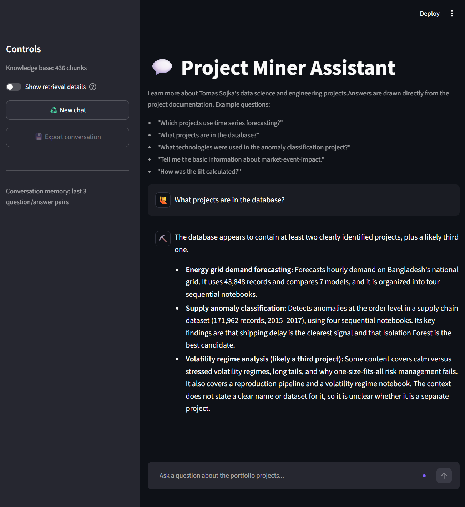
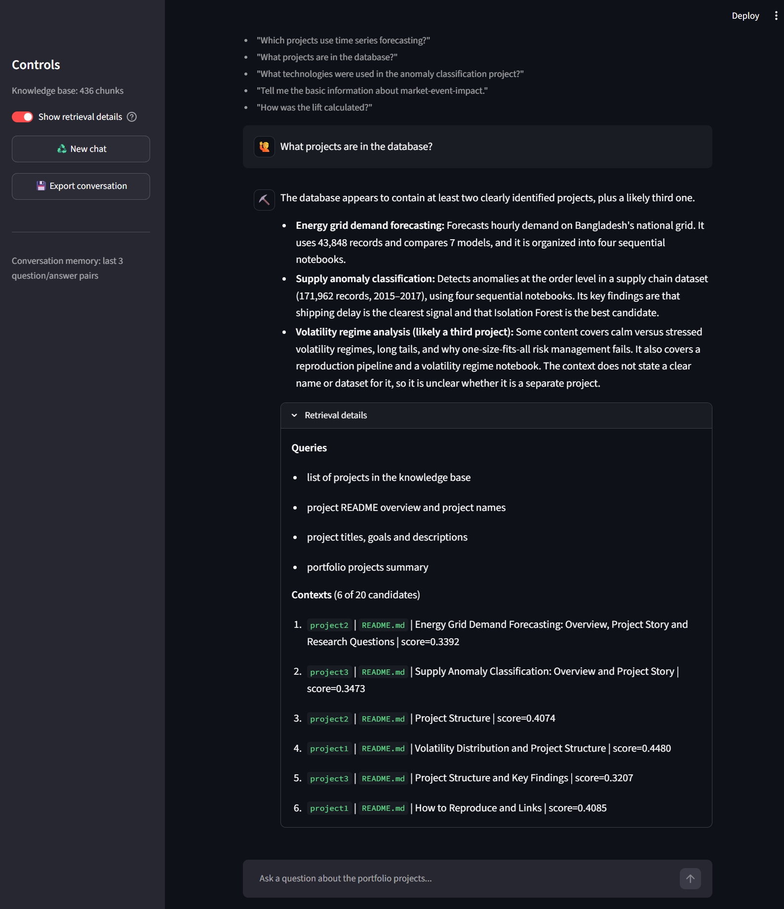
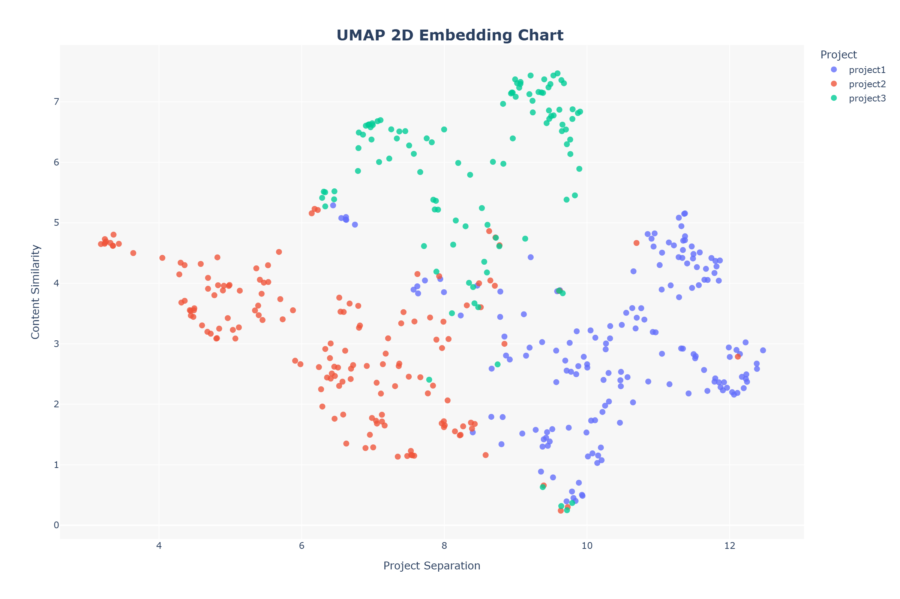
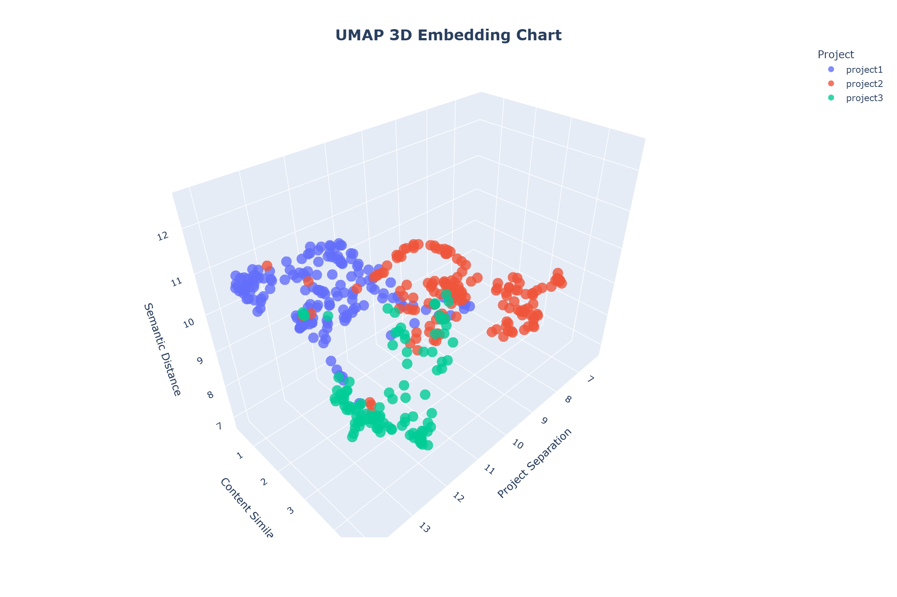

# 🤖 Project Miner Assistant
> A conversational RAG assistant that answers questions about my portfolio projects.
> Built on a ChromaDB knowledge base of **XXX chunks** from **4 GitHub projects** (READMEs, methodology notes and chart descriptions).

`retrieval-augmented-generation + query rewriting + LLM reranking + grounded answers`

`pandas` `OpenAI` `ChromaDB` `scikit-learn` `umap-learn` `Streamlit`

---

## ⚡ Quick start
1. **Install dependencies** (Python 3.12 or later)   
   `pip install -r requirements.txt`  
2. Create a .env file and insert your OpenRouter API key   
   `OPENROUTER_API_KEY=your_key`   
3. Save the file in the project root, next to app.py (see Project structure)   
4. Run the app by typing one of these commands in the terminal   
   `python -m streamlit run app.py`   
5. The app opens in your browser, usually at http://localhost:8501.

---

## 🧭 Project story
The project follows a **retrieve, then answer** approach. The assistant answers only from the content of my portfolio repositories and does not rely on general knowledge
1. **Build the knowledge base**: download the project files from GitHub, describe images with a vision model, and split the text into overlapping, structured chunks (headline, summary, content)
2. **Embed and store**: attach metadata (project, source, type), create embeddings and save them in a persistent ChromaDB collection
3. **Retrieve and rerank**: rewrite the user question into search queries, retrieve candidates and let an LLM select the most useful contexts
4. **Answer**: generate a response grounded in the selected contexts, in the language of the user's question

---

## 🎯 Research questions
The project is built around four core questions:

- Can a small RAG pipeline reliably answer questions about several different projects?
- Does **query rewriting** help with follow-up questions and multipart questions?
- Does **LLM reranking** improve the quality of the selected contexts?
- How should the assistant behave when the knowledge base has no answer?

---

## 🖥️ Application

**Main finding:** the assistant gives grounded, multilingual answers, and every answer can be traced back to its retrieved chunks.



<u>Screenshot description:</u> *Chat view with an answer.* The user asks a question and the assistant replies using only the retrieved contexts.



<u>Chart description:</u> *Retrieval details panel.* It shows the generated search queries, the selected contexts (project, source, headline, score) and how many candidates were considered.

---

## 🧱 Pipeline

```text
User question
   │
   ▼
Query rewriting   (recent history + question → 1..n English search queries)
   │
   ▼
Embedding         (all queries in one API call)
   │
   ▼
ChromaDB search   (up to 20 chunks per query, merged by rank, deduplicated)
   │
   ▼
LLM reranking     (up to 6 most useful contexts)
   │
   ▼
Answer generation (grounded in contexts, in the user's language)
```

---

## 📁 Project structure

```text
project-miner-assistant/
├── config/  
│   └── settings.py  
├── data/  
│   ├── assets/
│   ├── processed/
│   └── raw/  
├── notebooks/
│   ├── 01_knowledge_base_setup.ipynb
│   └── 02_rag_engine.ipynb
├── results/  
│   ├── figures/  
│   └── tables/
├── .env                               # OPENROUTER_API_KEY (not committed)
├── app.py
└── requirements.txt
```

---

## 🔑 Key Findings
- **Query rewriting** turns follow-up questions into self-contained queries and splits multipart questions into separate searches.
- **Merging and deduplication** of results from several queries increases coverage.
- **LLM reranking** narrows up to 20 candidates per query down to at most 6 contexts.
- **Grounded answers** are generated only from the selected contexts. If none are found, the app returns a fallback message.
- **Fallbacks** keep the app working: if rewriting fails it uses the original question, and if reranking fails it uses the top candidates.
- **Short memory** keeps the last 3 question and answer pairs.
- **Meta questions** such as "Which projects are in the database?" are the weakest spot of RAG, because retrieval returns only a few chunks. Explicit project names in the metadata and prompt help here.

| Step | Purpose | Failure behavior |
|---|---|---|
| Query rewriting | Self-contained English search queries | Use the original question |
| Retrieval | Up to 20 chunks per query | Fallback answer if nothing is found |
| Reranking | Select up to 6 contexts | Answer from the candidates |
| Generation | Grounded answer in the user's language | Error message |

**Models**
- Chat: `claude-sonnet-5.5`
- Embeddings: `text-embedding-3-small`
- Both are accessed through **OpenRouter** with the OpenAI SDK.

🏆 **Result:** a transparent assistant where the user can inspect queries, sources and scores for every answer.

---

## 🌡️ Model settings
The `temperature` parameter controls how much the model varies its output. Lower values give stable, factual results. Higher values give more creative but less reliable ones.

| Temperature | Behavior | Used in the pipeline |
|---|---|----------------------|
| `0.0` | Deterministic ranking | Yes                  |
| `0.1` | Near-deterministic rewriting | Yes                  |
| `0.2` | Very low variation, stable and precise output | Yes                  |
| `0.3` | Low variation, factual answers with slightly natural wording | Yes                  |
| `0.4` | Mild variation, factual with more flexible phrasing | ---                  |
| `0.5` | Balanced between consistency and variety | ---                  |
| `0.6` | Moderate creativity, more varied wording | ---                  |
| `0.7` | Creative, diverse phrasing (typical chat default) | ---                  |
| `0.8` | Highly creative, noticeably different outputs per run | ---                  |
| `0.9` | Very creative, higher risk of drifting from the facts | ---                  |
| `1.0` | Maximum variety, least predictable and least reliable | ---                  |

---

## 🗂️ Knowledge base

- **Projects:** Market Event Impact, Energy Grid Demand Forecasting, Supply Anomaly Classification, Project Miner Assistant
- **Content:** READMEs, methodology notes and image descriptions generated by a vision model
- **Size:** XXX chunks
- **Metadata:** project, source, type, headline
- **Store:** persistent ChromaDB collection

### Embedding map

**Main finding:** chunks from the same project form visible clusters, so the embeddings separate the three projects well. Some chunks overlap between clusters, mainly generic ones such as "How to Reproduce" or "Project Structure".


<u>Chart description:</u>   
*UMAP 2D projection of all chunks.* Each point is one chunk, coloured by project. `project2` (energy grid) is clearly separated on the left, `project3` (supply anomalies) forms clusters at the top, and `project1` (market events) sits on the right and bottom. Points in the middle are chunks with similar, generic content.

---


<u>Chart description:</u>   
*UMAP 3D projection.* The third dimension confirms the same structure. Each project occupies its own region, with a small mixed zone in the centre. This explains why retrieval can occasionally return generic chunks from the wrong project.

Interactive versions: [umap_2d_chart](data/assets/umap_2d_chart.html) and [umap_3d_chart](data/assets/umap_3d_chart.html)

---

## 🔁 How to reproduce
1. Clone the repository
2. Follow the **Quick start** above

**Optional**: rebuild the knowledge base
- `01_knowledge_base_setup.ipynb`: downloads the project files, analyzes images, creates chunks and embeddings, stores them in ChromaDB and visualizes them with PCA and UMAP
- `02_rag_engine.ipynb`: step-by-step version of the RAG engine, for experiments and debugging

**Features in the app**
- Retrieval details expander (queries, contexts, scores)
- Reset of the conversation and debug state
- Export of the conversation to **JSON** and **TXT**

---

## 🔗 Links
- [app.py](app.py)
- [01_knowledge_base_setup.ipynb](notebooks/01_knowledge_base_setup.ipynb)
- [02_rag_engine.ipynb](notebooks/02_rag_engine.ipynb)
- [Market Event Impact](https://github.com/thomas819-coder/market-event-impact)
- [Energy Grid Demand Forecasting](https://github.com/thomas819-coder/energy-grid-demand-forecasting)
- [Supply Anomaly Classification](https://github.com/thomas819-coder/supply-anomaly-classification)
